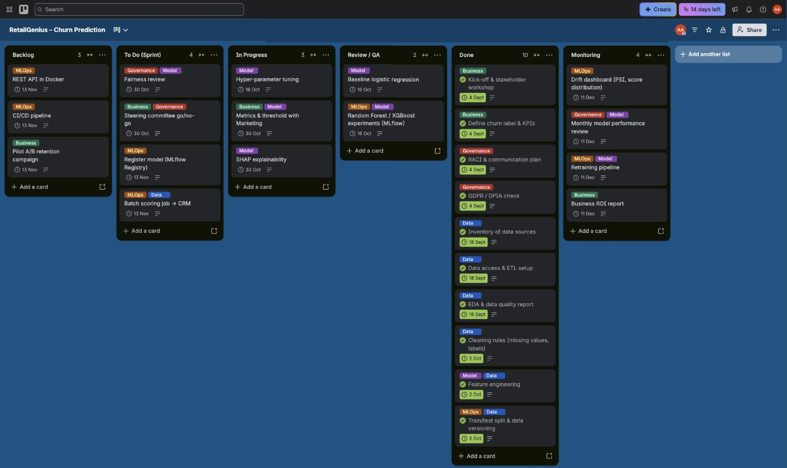

# Part 1 – Functional Framing of the Churn Prediction Project

RetailGenius is a fast-growing international e-commerce marketplace. It wants to use its data to keep more of its customers. The first AI project in its data strategy is churn prediction, and this part is our framing of that project before any code is written.

## 1. Project Strategy

### 1.1 Strategic objectives

From the stakeholder interviews, we see four objectives for the project:

| # | Objective | What it means in practice |
|---|-----------|---------------------------|
| O1 | Reduce churn | Spot customers who are likely to leave early enough that we can still do something about it, and bring the churn rate down. |
| O2 | Spend the retention budget better | Send vouchers, cashback and calls to the customers who are actually at risk and worth keeping, instead of to everyone. |
| O3 | Understand why people leave | Give Product, Marketing and Customer Support the main reasons behind churn (complaints, short tenure, long delivery distance, and so on), not just a score. |
| O4 | Build a base for future AI projects | Set up customer features, an MLOps pipeline and governance that later use cases (recommendations, fraud detection) can reuse. |

The question we want the project to answer is: which active customers are likely to churn soon, why, and what action has the best chance of keeping them?

### 1.2 KPIs

We would follow the project at three levels. Model metrics tell us if the predictions are good. Business metrics tell us if the predictions actually save customers. Operational metrics tell us if the system works in production.

| Level | KPI | Example target |
|-------|-----|----------------|
| Model | ROC-AUC and PR-AUC on the hold-out set | AUC of 0.90 or more |
| Model | Recall on churners (share of real churners we catch) | 80 % or more |
| Model | Precision among the top-k customers we score (limited by campaign capacity) | 60 % or more |
| Model | Calibration (Brier score) and score stability (PSI) | PSI below 0.2 |
| Business | Churn rate of contacted customers compared with a control group (A/B test) | 15 % lower |
| Business | Retention rate and repeat-purchase rate | +5 points |
| Business | Customer lifetime value saved minus campaign cost (ROI) | ROI above 3 |
| Business | CSAT / NPS of contacted customers | should not drop |
| Operational | API latency, freshness of batch scores | under 200 ms, updated daily |
| Operational | Adoption: share of retention campaigns that use the churn score | above 80 % |

### 1.3 How AI can help retention

Today, RetailGenius mostly notices churn after the customer has already gone. With a model, we can score customers before that happens and act while there is still time.

The model also lets us personalise the response. If we combine the risk score with the main reasons behind it (we get these from SHAP, see Part 3), a customer who complained can get a call from support, while a price-sensitive customer gets a coupon. Ranking customers by risk times value means a limited budget goes where it brings the most back.

At a higher level, the explanations show structural problems, such as weak onboarding or slow complaint handling, that Product can fix for everyone. Finally, the results of each campaign come back as new labels, so the model keeps improving over time.

## 2. Project Design

### 2.1 Data

**Relevant data sources**

| Domain | Source | Example features |
|--------|--------|------------------|
| Customer profile | CRM (SQL) | tenure, city tier, gender, marital status, number of addresses |
| Behaviour | Platform logs / clickstream (NoSQL, data lake) | hours on the app, devices, sessions, product views, searches |
| Transactions | Order system | number of orders, days since last order, order amount growth, preferred category, payment mode |
| Marketing | Campaign tool | coupons used, cashback, email opens, campaign responses |
| Customer support | Ticketing tool | complaints, number of tickets, resolution time, satisfaction score |
| Logistics | Warehouse and delivery systems | warehouse-to-home distance, late deliveries, returns |
| External | Review sites, social media, competitor prices, economic and demographic data | review sentiment, price gap with competitors, regional income |

Before anything else, the business has to agree on what churn means. A simple definition would be "no purchase and no login for 90 days". The label drives everything after it, so this needs to be decided and signed off early.

**Challenges and how we would handle them**

| Challenge | Why it matters | How we would handle it |
|-----------|---------------|------------------------|
| Data silos (CRM, logs, support, marketing) | We don't get a full view of the customer | A common customer ID, ETL with NiFi/Talend into the data lake, and a feature store |
| Data quality: missing values, inconsistent labels ("Phone" vs "Mobile Phone"), outliers | The model learns from bad data | Automatic data quality checks (for example Great Expectations), imputation, written cleaning rules |
| Unclear label and data leakage | Results look better than they really are | A clear churn definition, a time-based split, only features known before the prediction date |
| Class imbalance (about 17 % churners) | The model can ignore the minority class | Stratified splits, class weights, PR-AUC as a metric, threshold tuning |
| Privacy (GDPR) | Legal risk | Data minimisation, pseudonymisation, a clear legal basis, a DPIA, no sensitive attributes, access control |
| Fairness | Some groups could be treated unfairly | A bias check across gender and region; protected attributes are not used for targeting |
| Data volume | Pipelines become slow | Distributed processing (Spark) and incremental feature computation |

### 2.2 Models

**Which models make sense**

| Model | Strengths | Weaknesses | Role in the project |
|-------|-----------|------------|---------------------|
| Logistic regression | Simple, fast, easy to explain | Only captures linear effects | Baseline |
| Random Forest | Robust, handles non-linear effects | Bigger, probabilities less well calibrated | Challenger |
| Gradient boosting (XGBoost, LightGBM, CatBoost) | Usually the best on tabular data, handles missing values, works well with SHAP | Needs some tuning | Main candidate |
| Survival models (Cox, survival forests) | Predict *when* a customer will leave | Labels are more complex | Later iteration |
| Neural networks on clickstream sequences | Can use raw behaviour | Need a lot of data, hard to explain | Future work |

**Training, validation and testing**

We would start by splitting the data into a stratified training set and test set (80/20). In production we would also keep an out-of-time test set: train on older months and test on the most recent one, since that's closer to how the model will be used.

On the training set, we use stratified 5-fold cross-validation to compare models and tune hyper-parameters (grid search, random search or Optuna). The test set is used only once at the end. There we look at ROC-AUC, PR-AUC, recall, precision, F1 and calibration, and at a business metric such as the expected profit at the chosen threshold.

The threshold itself is decided with Marketing, because it depends on how many customers they can contact and on what a false alarm costs compared with a missed churner. Before going live, we also check the explanations (SHAP) and fairness.

**Versioning and serving**

- Code: Git and GitHub, with feature branches, pull requests, code review and CI that runs the linter and tests.
- Data: dated snapshots in the data lake (or DVC). We record the dataset version with each run.
- Experiments and models: MLflow Tracking for parameters, metrics and artifacts, and the MLflow Model Registry for versions, aliases (`@champion`, `@challenger`) and approval tags.
- Serving: the model is packaged as an MLflow model and used in two ways. A daily batch job writes the scores into the CRM, and a REST API (MLflow serving or FastAPI in Docker) handles real-time calls, for example from the support tool.

### 2.3 Deployment

| Strategy | How it works | When we would use it |
|----------|--------------|----------------------|
| Batch scoring | Score all customers every day or week and push the results to the CRM | Default option for retention campaigns |
| Real-time API | Score a customer on request | Support tickets, in-app offers |
| Shadow deployment | The new model scores in parallel but nobody acts on its output | Before replacing a model |
| Canary / A-B test | The new model is used for a small share of customers first | To measure the real business uplift |
| Blue-green | Two environments with an instant switch and rollback | Releases without downtime |

For production, there are a few more things to think about:

- Scalability: containers, Kubernetes, autoscaling.
- Security: authentication, encryption, secrets management.
- GDPR: the customer's right to object to profiling, and data retention rules.
- Monitoring and logging, plus a clear rollback plan.
- A CI/CD pipeline: tests, image build, staging, approval, then production.
- Running costs, and integration with the existing SQL/NoSQL systems and the CRM.
- A model card that documents what the model does and where its limits are.

### 2.4 Monitoring

| What we watch | Metric | How often | When we raise an alert |
|---------------|--------|-----------|------------------------|
| Data quality | schema, % missing, value ranges | every batch | the pipeline fails |
| Data drift | PSI or KS test per feature | weekly | PSI above 0.2 |
| Prediction drift | distribution of scores, % of customers flagged | weekly | ±30 % compared with the reference |
| Model performance | AUC, recall, precision, once labels are known (about 90 days later) | monthly | AUC drops by more than 5 points |
| Business impact | churn of the treated group vs. the control group, ROI | monthly | uplift no longer significant |
| Service | latency, error rate, uptime | real time | SLO breached |

**What we do when the model drifts**

1. Detect it with automatic drift reports (for example Evidently AI) and a dashboard.
2. Find the cause. Is it a data problem, such as a broken pipeline, or has customer behaviour really changed (a new competitor, a seasonal effect)?
3. Fix the data problem, or retrain on recent data. We plan a monthly retrain anyway, plus an extra one when an alert fires.
4. Validate the new model. The challenger has to beat the current champion on a recent out-of-time set and pass the fairness checks.
5. Release it through shadow mode or a canary first, then move the `@champion` alias in the registry. The previous version stays available for rollback.

## 3. Project Team

### 3.1 Roles and skills

| Role | What they do | Key skills |
|------|--------------|-----------|
| Business sponsor (e.g. Head of CRM) | Sets the objectives, owns the budget and the KPIs | Retention strategy, decision-making |
| Product owner | Manages the backlog and priorities, links business and tech | Agile, business analysis, communication |
| Project manager / Scrum master | Planning, risks, ceremonies, reporting | Scrum, risk management |
| Data engineer | Ingestion, ETL, data quality, feature store | SQL, Spark, NiFi/Talend, cloud, data modelling |
| Data scientist | EDA, features, modelling, evaluation, explainability | Python, ML, statistics, SHAP |
| ML engineer / MLOps | Packaging, CI/CD, serving, monitoring | Docker, MLflow, Kubernetes, APIs |
| Data analyst | KPIs, dashboards, campaign analysis | BI tools, SQL, A/B testing |
| Integration engineer | Connects the model to the CRM, the app and the support tool | APIs, back-end development |
| Data governance / DPO | GDPR compliance, data access, ethics | Privacy law, governance |
| Business experts (Marketing, Customer Support) | Bring domain knowledge and feature ideas, act on the scores | Knowing the customers |

### 3.2 Collaboration and alignment

We would run this as one cross-functional squad rather than separate business and tech teams. Everyone takes part in the same Scrum ceremonies and works from the same Trello/Jira board. Shared tools help a lot here: GitHub, MLflow, a shared drive or Confluence, a data dictionary, and above all one written definition of churn that everybody uses.

To stay aligned with the strategy, the team's OKRs come straight from objectives O1 to O4, and each sprint goal is linked to a KPI. Stakeholders see a demo at every sprint review. A task only counts as done once the business has validated it.

Marketing and Customer Support are the ones who will actually use the predictions, so they need to be involved from the start. We would design the retention actions with them (one playbook per main churn reason), run the A/B tests together, and hold a short weekly sync. Campaign results and feedback from support agents come back to the data team. The scores go into the tools they already use, such as a field in the CRM or the support console, rather than a new app they would have to open.

## 4. Project Governance & Communication

### 4.1 Stakeholders and communication plan

| Stakeholder | Interest / influence | What they need from us | Channel | Frequency |
|-------------|---------------------|------------------------|---------|-----------|
| Executive committee / sponsor | High / High | ROI, progress, risks, go/no-go decisions | Steering committee, one-page dashboard | Monthly |
| Marketing executives | High / High | Lists of at-risk customers, churn reasons, campaign results | Sprint review, BI dashboard | Every two weeks |
| Product managers | High / Medium | Churn reasons linked to features and UX | Workshops, reports | Monthly |
| Customer support | Medium / Medium | Risk level and reasons for each customer, inside their tool | Training, CRM field, FAQ | At launch, then monthly |
| Data team | High / High | Requirements, data access | Daily stand-up, Jira/Trello | Daily |
| Tech / infrastructure | Medium / High | Integration, security, scalability | Architecture review | At each milestone |
| DPO / legal | Medium / High | GDPR compliance | DPIA review | At each milestone |
| Finance | Medium / Medium | Costs and ROI | Steering committee | Quarterly |

### 4.2 Governance bodies

| Body | Who is in it | Purpose | Frequency |
|------|--------------|---------|-----------|
| Steering committee | Sponsor, heads of Marketing, Tech and Data, product owner | Strategy, budget, go/no-go, major risks | Monthly |
| Project committee | Product owner, project manager, leads | Planning, risks, dependencies | Weekly |
| Sprint ceremonies | The squad and business experts | Planning, daily stand-up, review/demo, retrospective | Two-week sprints |
| Architecture board | Tech lead, data engineer, security | Technical choices and integration | At each milestone |
| Model risk and ethics review | Data science lead, DPO, business | Validate the model, fairness and explanations before go-live | Before each release |
| Data governance council | Data owners, DPO | Data quality, access, lineage | Monthly |

### 4.3 Communicating model outputs

Technical and non-technical people need very different things from the model.

For the technical teams, we share the MLflow UI (runs, metrics, model versions), the Sphinx documentation, a model card (data used, metrics, known limits), the ROC/PR curves and confusion matrix, the SHAP plots and the drift reports.

For everyone else, we keep it simple. Instead of a raw probability, each customer gets a risk level: High, Medium or Low. Next to it, we show the three main reasons in plain language, taken from SHAP: for example "complained recently, new customer, many delivery addresses". We add a suggested action and a dashboard with the business KPIs (customers saved, ROI). Short training sessions and an FAQ explain what the score means, and also what it does not mean.

## 5. AI Project Management Methodology

### 5.1 Our choice: CRISP-DM inside an Agile (Scrum + Kanban) setup

CRISP-DM gives us the steps of a data science project: business understanding, data understanding, data preparation, modelling, evaluation and deployment, with the possibility to loop back. Scrum gives the rhythm, with two-week sprints, regular demos and feedback from stakeholders. A Kanban board (Backlog, To do, In progress, Review, Done) makes the flow of tasks visible and limits how much is in progress at once. After deployment, MLOps practices (monitoring, retraining) keep the model alive.

### 5.2 Why this fits the project

AI projects are uncertain by nature. At the start we don't know which data or which model will work, so a fixed waterfall plan would not hold for long. Short iterations work better.

CRISP-DM accepts that we will go back from evaluation to business or data understanding, which is what really happens in ML projects. Frequent demos keep Marketing and Support involved and help us catch misunderstandings early, like a disagreement on the churn definition. This setup also lets us deliver a first useful version quickly (a baseline model with batch scoring) and improve it step by step.

### 5.3 Risks and mitigation

| Risk | Probability | Impact | Mitigation |
|------|-------------|--------|-----------|
| Poor data quality or data silos | High | High | Data audit in sprint 0, data quality rules, a data engineer in the squad |
| Wrong or unclear churn definition | Medium | High | Workshop with the business at the start and formal sign-off |
| Data leakage making results look too good | Medium | High | Time-based split and a review of every feature |
| The business doesn't use the model | Medium | High | Design it with them, explain the predictions, integrate into existing tools, train users |
| GDPR or ethics problem | Low | High | DPO involved early, DPIA, fairness audit |
| Model drift after deployment | High | Medium | Monitoring and a retraining plan |
| Scope creep (recommendations, fraud, ...) | Medium | Medium | A clear MVP scope and a backlog prioritised by the product owner |
| Too much depends on one person | Medium | Medium | Documentation, pair work, code reviews |
| Cost overrun (cloud, extra iterations) | Medium | Medium | Timeboxed experiments and budget tracking |

### 5.4 Handling costs and planning drift caused by model iterations

Model work can go on forever if nobody sets limits, so we would put some guardrails in place:

- Timebox each experiment, for example one sprint per modelling idea, with a clear go/no-go criterion at the end.
- Agree with the business on what "good enough" means (for example AUC of 0.90 and recall of 80 %), and stop optimising once we get there.
- Ship a simple baseline early, so the business gets value while we keep improving the model.
- Keep a buffer of about 15–20 % in the budget and planning for the uncertainty that comes with AI work.
- Track the compute cost of each experiment, and choose the cheaper model when the gain is small.
- Re-plan at every sprint review based on velocity, and take bigger deviations to the steering committee.

### 5.5 Mock project on Trello (Kanban)

We set up a board called "RetailGenius – Churn Prediction" with six lists: Backlog, To Do (Sprint), In Progress, Review / QA, Done and Monitoring. Labels show the type of work (Business, Data, Model, MLOps, Governance), and each card has an owner, a due date and a checklist.

| Phase (CRISP-DM) | Cards |
|------------------|-------|
| Sprint 0 – Business understanding | Kick-off and stakeholder workshop · Define the churn label and KPIs · RACI and communication plan · GDPR / DPIA check |
| Sprint 1 – Data understanding | Inventory of data sources · Data access and ETL setup · EDA and data quality report |
| Sprint 2 – Data preparation | Cleaning rules (missing values, labels) · Feature engineering · Train/test split and data versioning |
| Sprint 3 – Modelling | Baseline logistic regression · Random Forest / XGBoost experiments in MLflow · Hyper-parameter tuning |
| Sprint 4 – Evaluation | Metrics and threshold agreed with Marketing · SHAP explanations · Fairness review · Steering committee go/no-go |
| Sprint 5 – Deployment | Register the model in the MLflow Registry · Batch scoring job to the CRM · REST API in Docker · CI/CD pipeline · Pilot A/B campaign |
| Run – Monitoring | Drift dashboard · Monthly performance review · Retraining pipeline · Business ROI report |

The screenshot below shows the board in the middle of the project: sprints 0 to 2 are done, modelling and evaluation are in progress or in review, and deployment and monitoring are still planned. The board is available at <https://trello.com/b/x7zR3Fet/retailgenius-churn-prediction>.

