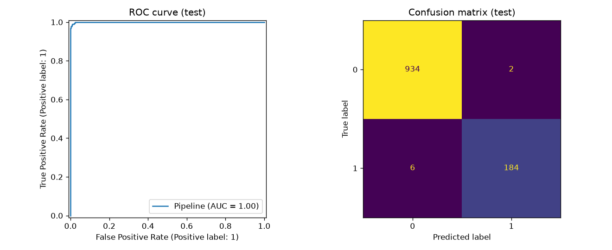
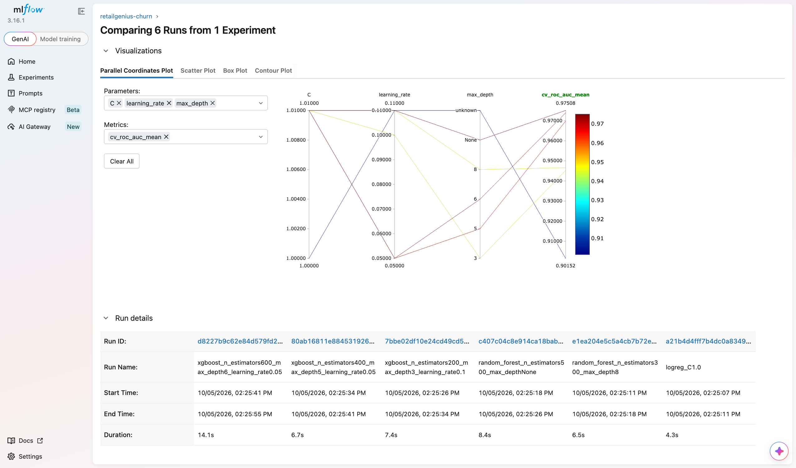
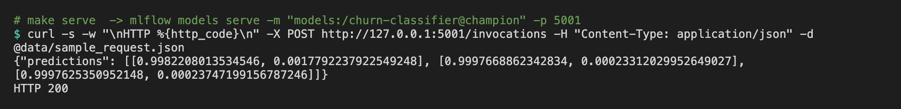

# Part 2 – Technical Implementation

Code repository: <https://github.com/ArmanAhmed00/AI_Project_Methodology_> (shared with dinamedy@hotmail.com)

In this part we turn the framing from Part 1 into a working project. As the brief says, the goal was not the best possible score. We wanted a project that is clean, reproducible and close to what a team would put into production.

## 1. Dataset

We used the [E-Commerce Customer Churn Analysis and Prediction](https://www.kaggle.com/datasets/ankitverma2010/ecommerce-customer-churn-analysis-and-prediction) dataset from Kaggle (sheet `E Comm`). It has 5,630 customers and 20 columns, with a binary target `Churn`. About 16.8 % of customers churned, so the classes are imbalanced.

Our EDA (`notebooks/01_eda.ipynb`) found three issues to deal with:

- Seven numerical columns have missing values, each around 4.5–5.5 %: `DaySinceLastOrder` (307), `OrderAmountHikeFromlastYear` (265), `Tenure` (264), `OrderCount` (258), `CouponUsed` (256), `HourSpendOnApp` (255) and `WarehouseToHome` (251). We impute them inside the model pipeline (median for numbers, most frequent value for categories), so exactly the same logic runs at serving time.
- Some categories appear under two names. We merged `Phone` into `Mobile Phone`, `CC` into `Credit Card`, `COD` into `Cash on Delivery` and `Mobile` into `Mobile Phone`.
- `CustomerID` is just an identifier, so we never use it as a feature.

## 2. Best practices we followed

| Requirement | What we did |
|-------------|-------------|
| Versioning and collaboration | Git and GitHub, with feature branches merged into `main`. Models are versioned in the MLflow registry and exported to `models/`. |
| Code structure | A layout adapted from cookiecutter-data-science: `data/raw`, `data/interim`, `data/processed`, `models`, `notebooks`, `reports`, `docs`, `src`, `tests` |
| Separate workflow scripts | `data.py` (preparation), `features.py` (feature engineering), `train.py` (training), `register.py` (registry), `predict.py` (inference), `explain.py` (XAI) |
| Standardisation | Everyone in the group uses Python 3.13 (`.python-version`). Code follows PEP8, checked with black (formatter) and flake8 (linter) through `make lint`. |
| Reproducibility | Poetry with pinned versions in `pyproject.toml` and `poetry.lock`, a `requirements.txt` for pip users, fixed random seeds, and `python_env.yaml` for MLflow Projects |
| Documentation | Sphinx (autodoc, napoleon, autosummary, Read-the-Docs theme) builds the docs from our Google-style docstrings with `make docs` |
| Tests | pytest unit tests for cleaning, feature engineering and the full pipeline |
| Tracking | MLflow Tracking logs parameters, CV and test metrics, ROC and confusion-matrix figures, and the model with its signature and an input example |
| Packaging | MLflow Projects (`MLproject`) with the entry points `prepare`, `train`, `sweep`, `register`, `explain` and `main` |
| Model registry | MLflow Model Registry: model `churn-classifier`, several versions, the `@champion` alias, a description and a `validation_status` tag |
| Serving | MLflow serving: a local REST API with `mlflow models serve` on port 5001 |
| Bonus (cloud) | A `Dockerfile` that serves the exported champion model. It builds locally and is ready for Cloud Run, Render or Azure Container Apps. |

## 3. ML pipeline

```
raw xlsx  ->  data.py: remove duplicates, fix labels, stratified 80/20 split
          ->  Pipeline[ FeatureBuilder -> ColumnTransformer (impute + one-hot) -> classifier ]
          ->  5-fold stratified CV + hold-out test  ->  logged to MLflow
```

We added three engineered features in `FeatureBuilder`:

- `CashbackPerOrder`: cashback divided by the number of orders.
- `CouponPerOrder`: coupons divided by the number of orders.
- `IsNewCustomer`: 1 if tenure is one month or less.

All the preprocessing lives in a single scikit-learn `Pipeline`. That means the logged model takes raw customer records as input, and we avoid differences between training and serving.

We save the model in MLflow's skops format, which is safer than pickle, with an explicit list of trusted types. Numerical inputs are cast to float so that the model signature still accepts missing values at prediction time.

## 4. Experiments (MLflow tracking)

`make sweep` runs six experiments: a logistic regression baseline, two Random Forests and three XGBoost configurations. Each run logs its hyper-parameters, the mean and standard deviation of the CV ROC-AUC, and the ROC-AUC, PR-AUC, F1, precision, recall and accuracy on the train and test sets.

| Run | CV ROC-AUC | Test ROC-AUC | Test PR-AUC | Test F1 | Test recall |
|---|---:|---:|---:|---:|---:|
| logreg_C1.0 | 0.902 | 0.894 | 0.696 | 0.627 | 0.837 |
| random_forest_n_estimators300_max_depth8 | 0.947 | 0.963 | 0.863 | 0.737 | 0.863 |
| random_forest_n_estimators500_max_depthNone | 0.975 | 0.999 | 0.995 | 0.959 | 0.979 |
| xgboost_n_estimators200_max_depth3_learning_rate0.1 | 0.945 | 0.961 | 0.868 | 0.775 | 0.726 |
| xgboost_n_estimators400_max_depth5_learning_rate0.05 | 0.970 | 0.997 | 0.984 | 0.921 | 0.884 |
| **xgboost_n_estimators600_max_depth6_learning_rate0.05 (champion)** | 0.974 | 0.999 | 0.997 | 0.979 | 0.968 |

We picked the champion using cross-validation AUC and not the test set, so the test set stays a fair final check. We also restricted the choice to the XGBoost runs, because that is the model we explain with SHAP's TreeExplainer in Part 3.

The winner is `xgboost_n_estimators600_max_depth6_learning_rate0.05`: XGBoost with 600 trees, max depth 6 and learning rate 0.05. It is registered as `churn-classifier` version 2 with the `@champion` alias. Version 1 is the same configuration from the standalone `make sweep` run; version 2 comes from the `mlflow run` project run and replaced it. Its CV AUC is 0.974, the best of the XGBoost runs. On the test set it reaches a ROC-AUC of 0.999, a PR-AUC of 0.997, an F1 of 0.979 and a recall of 0.968. In the confusion matrix, it catches 184 of the 190 churners and raises only 2 false alarms among 936 loyal customers.

The unbounded Random Forest has a slightly higher CV AUC (0.975). But it is about 20 times larger on disk and it isn't the model family we explain in Part 3, so we kept XGBoost.

These scores are much higher than what we would expect in real life, and we think we know why. In this Kaggle dataset, 557 rows are exact duplicates except for `CustomerID`, and 194 of the 1,126 test customers have a profile that also appears in the training set. A random split is therefore too optimistic. In a real project we would remove duplicate customers before splitting, and use an out-of-time split: train on past months, test on the latest month.







## 5. MLflow Projects, Registry and Serving

These are the main commands we used:

```bash
# the whole pipeline as an MLflow Project
mlflow run . -e main --env-manager local --experiment-name retailgenius-churn
# a single training run with parameters
mlflow run . -e train -P model=xgboost -P max_depth=4 --env-manager local \
            --experiment-name retailgenius-churn
# registry: best run -> churn-classifier, alias @champion
python -m churn.register
# local inference server
mlflow models serve -m "models:/churn-classifier@champion" -p 5001 --env-manager local
curl -X POST http://127.0.0.1:5001/invocations -H "Content-Type: application/json" \
     -d @data/sample_request.json
```

Here is the server's answer for three test customers. Each pair is `[P(stay), P(churn)]`:

```
{"predictions": [[0.9982208013534546, 0.0017792237922549248], [0.9997668862342834, 0.00023312029952649027], [0.9997625350952148, 0.00023747199156787246]]}
HTTP 200
```

All three are real loyal customers (label 0), and the model scores them that way. The second one has a missing `DaySinceLastOrder`, which the pipeline fills in at serving time without any problem.



When we launch the pipeline with `mlflow run`, the training runs show up as nested runs under the project run, so one full execution stays grouped together in the UI.
