# Part 3 – Explainable AI with SHAP

A churn score on its own isn't very useful to the people who have to act on it. A support agent needs to know *why* a customer is at risk before calling them. In this part we use SHAP to open up our champion model.

## 1. Setup

- Library: `shap==0.52.0`, added to `pyproject.toml` (Poetry) and to `requirements.txt`.
- Model: the champion from the Model Registry, `models:/churn-classifier@champion` (XGBoost, 600 trees, depth 6). We load it straight from MLflow, so we are explaining exactly the model that is served.
- Explainer: `shap.TreeExplainer`, which computes exact Shapley values for tree models. The values are in log-odds of churn. A positive value pushes a customer towards churning, a negative one towards staying.
- Data: the 1,126 customers of the test set, after the pipeline's own feature engineering and preprocessing. The features in the plots are therefore the ones the model really sees, for example `MaritalStatus_Single` after one-hot encoding, or our engineered `CashbackPerOrder`.
- Code: `src/churn/explain.py`, run with `make explain` (it is also the `explain` entry point in the `MLproject`). Every figure is saved in `reports/figures/shap/` and also logged to MLflow under a `shap-explanations` run, next to the training runs.
- Base value: on average the model outputs E[f(X)] = −1.544 log-odds, which is about a 17.6 % churn probability. That is close to the real churn rate of 16.8 %.

**The customer we explain.** For the single-customer plots, we took the real churner with the highest predicted risk in the test set (test row 404, `CustomerID` 54288). He is single, lives in a tier-3 city and has been a customer for only one month. He has already filed a complaint and placed his last order one day ago. He pays with an e-wallet, lives 29 km from the warehouse and mostly buys mobile phones. The model gives him a churn probability of almost 1.00 (f(x) = 9.20 log-odds), and he did churn.

## 2. Explaining one customer (force plot)

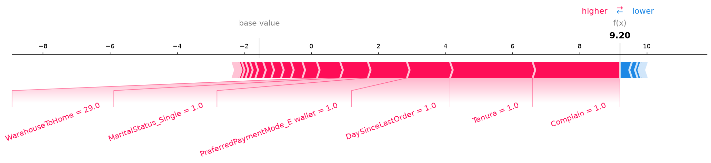

The force plot starts from the base value (−1.54) and shows which features push the prediction up (red) or down (blue), until it reaches f(x) = 9.20. Almost everything is red. The two biggest pushes come from Complain = 1 and Tenure = 1. Next come DaySinceLastOrder = 1, paying with an e-wallet, being single and the 29 km delivery distance. Only a few small blue arrows, like his 20 % increase in order amount, pull a little towards staying.

In short, he is at risk because he is a new customer who is already unhappy: he complained during his first month. An interactive version of this plot is in `01_force_plot_single.html`.

## 3. Explaining all customers at once

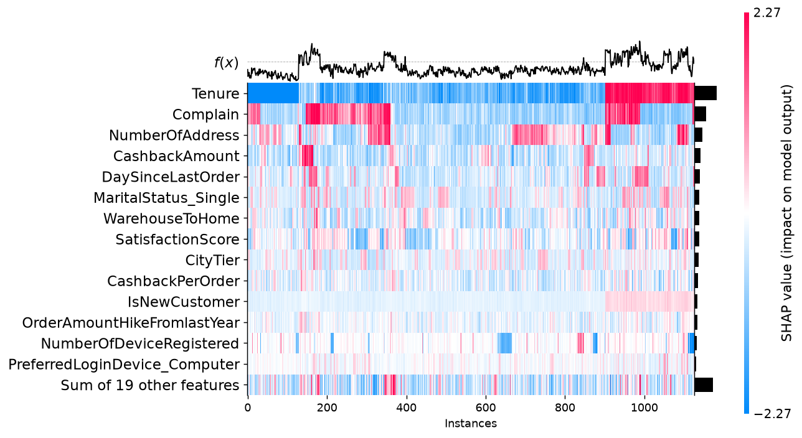

The heatmap has one column per test customer (1,126 of them) and one row per feature, coloured by SHAP value. Customers are grouped by how similar their explanations are, and the model output f(x) is drawn on top.

Tenure is clearly the dominant row. The group of customers on the right (around columns 900 to 1,120) has strongly red Tenure, meaning very new customers (`IsNewCustomer` is red there too), and the highest risk. A second high-risk group (around columns 140 to 360) is driven mostly by Complain. So the model sees two quite different churn profiles: newcomers and complainers.

There is also an interactive stacked force plot of all 1,126 customers in `02_force_plot_all.html`. It can be sorted by similarity, by output value or by any feature.

## 4. Summary plot for each class

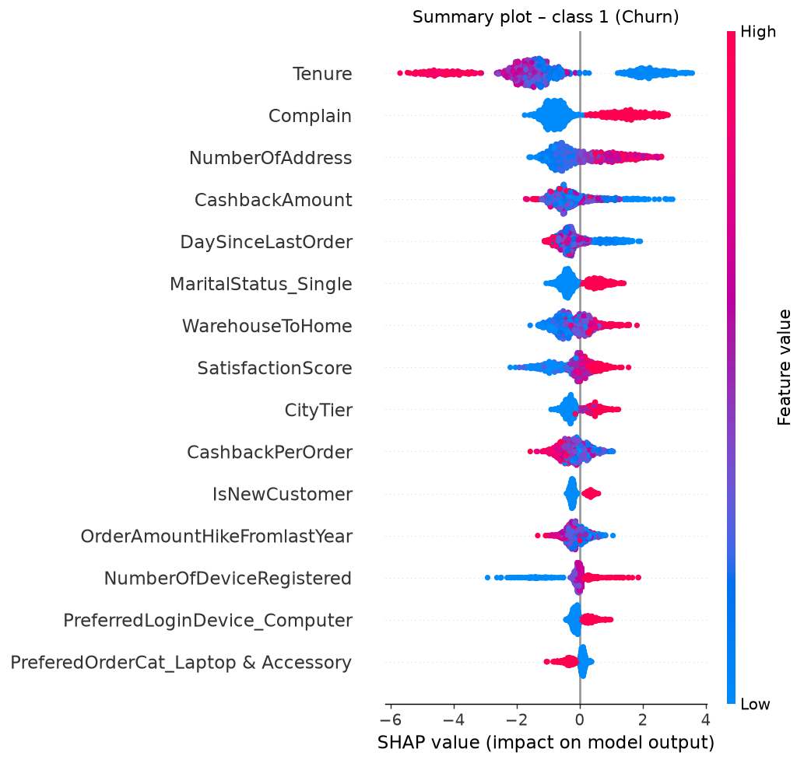

For class 1 (churn), each dot is a customer. Its horizontal position is the SHAP value and its colour is the feature value (red for high, blue for low). Low tenure (blue) gives large positive values, up to +3.5, while long tenure gives strongly negative ones, down to −6. Several other things push towards churn:

- having complained;
- having many addresses;
- receiving little cashback;
- having ordered recently;
- being single;
- living far from the warehouse;
- living in a higher city tier;
- having many registered devices.

Two effects surprised us: churners tend to have ordered *recently* (low `DaySinceLastOrder`), and a *higher* satisfaction score slightly increases the risk. Both are consistent across the dataset, but we see them as model behaviour that should be checked with the business, not as facts about customers.

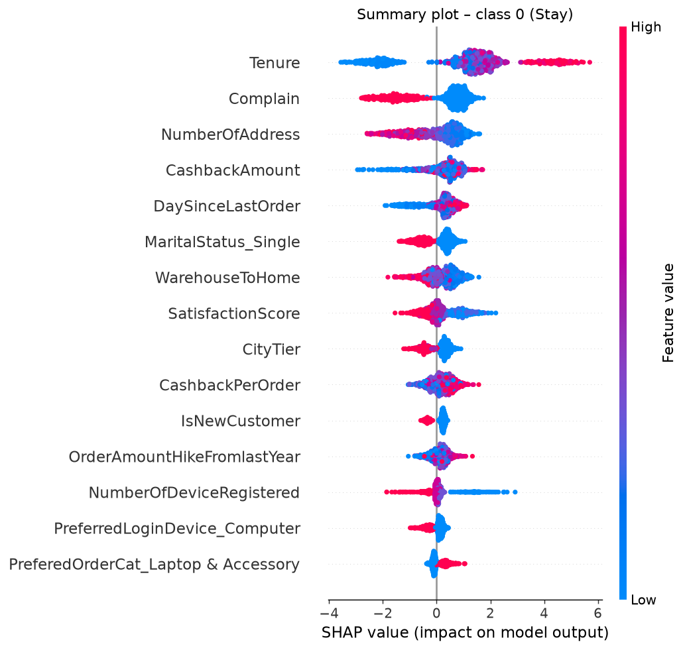

For class 0 (stay), the plot is an exact mirror of class 1. In a binary model the log-odds of staying are just the negative of the log-odds of churning, so every SHAP value flips sign. Long tenure and having no complaint now become the strongest reasons to stay. The order of the features doesn't change.

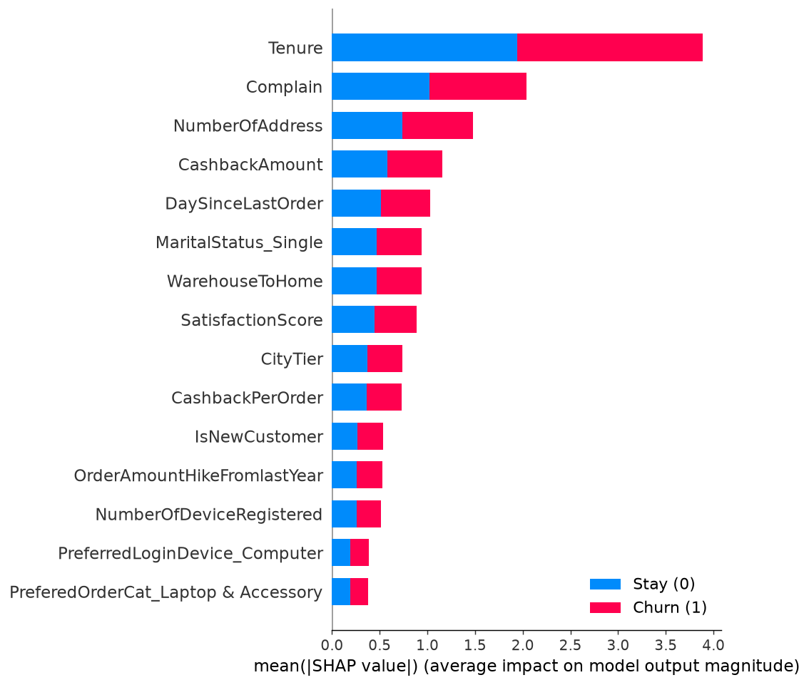

The bar chart per class confirms this: each feature has the same mean |SHAP| for both classes, so the blue and red parts are equal. The overall ranking is Tenure, then Complain, NumberOfAddress, CashbackAmount and DaySinceLastOrder.

## 5. Going further for one customer: waterfall plot

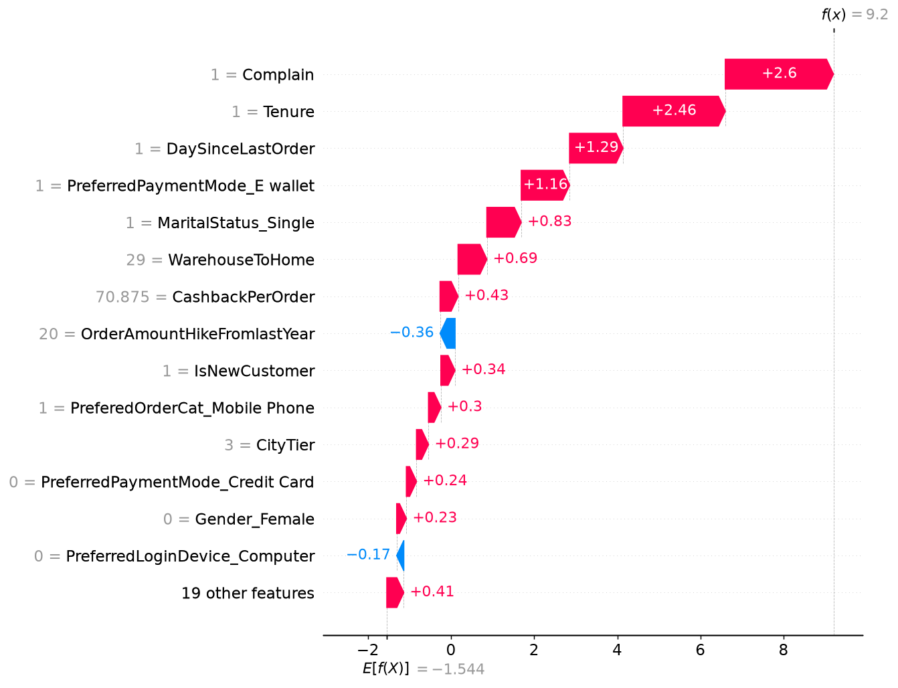

The waterfall plot tells the same story as the force plot, but with exact numbers. It goes from E[f(X)] = −1.544 at the bottom to f(x) = 9.2 at the top. Complain (+2.60) and Tenure (+2.46) alone add more than 5 log-odds. After that come DaySinceLastOrder (+1.29), paying with an e-wallet (+1.16), being single (+0.83), the 29 km distance (+0.69) and a high cashback per order (+0.43). Only the order amount increase (−0.36) and not using a computer to log in (−0.17) lower his risk. The 19 remaining features add +0.41 together.

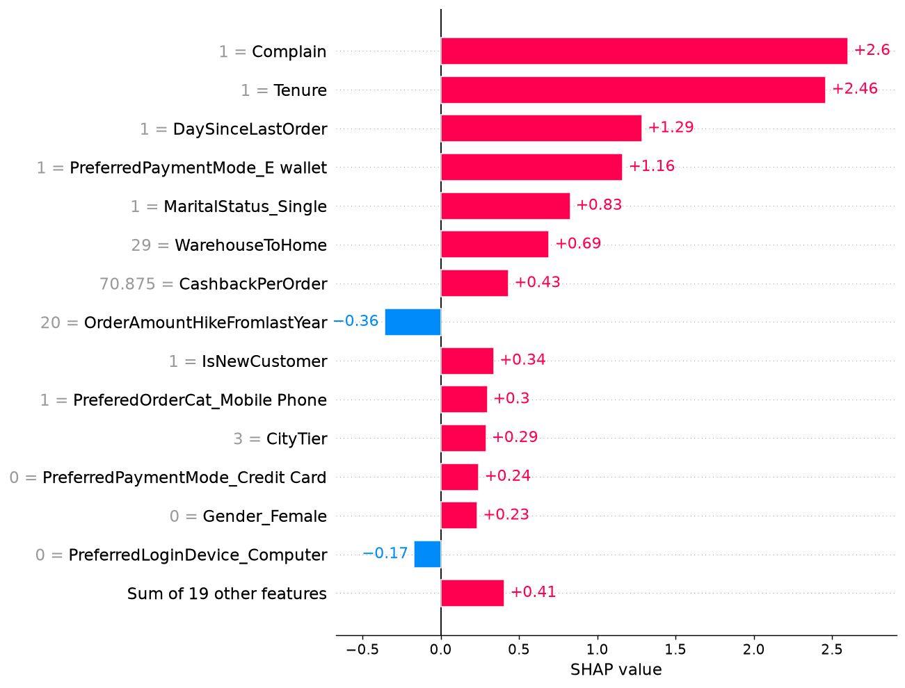

This local bar plot shows the same values sorted by size. It is the easiest format to turn into the "top 3 reasons" a support agent would see: complained, new customer, ordered very recently.

## 6. Mean SHAP plot (global importance)

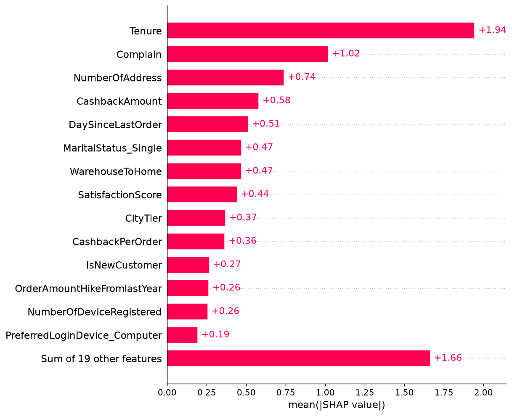

The mean absolute SHAP value measures how much a feature moves the prediction on average, whatever the direction. Tenure (1.94) matters about twice as much as Complain (1.02). Next come NumberOfAddress (0.74) and CashbackAmount (0.58). Unlike the built-in "gain" importance of XGBoost, this measure is consistent and is expressed in log-odds. The 19 smallest features still add up to 1.66, so a lot of small signals matter together.

Top 10 features (from `reports/figures/shap/mean_abs_shap.csv`):

| Rank | Feature | Mean \|SHAP\| (log-odds) |
|---:|---|---:|
| 1 | Tenure | 1.9447 |
| 2 | Complain | 1.0189 |
| 3 | NumberOfAddress | 0.7385 |
| 4 | CashbackAmount | 0.5793 |
| 5 | DaySinceLastOrder | 0.5136 |
| 6 | MaritalStatus_Single | 0.4694 |
| 7 | WarehouseToHome | 0.4691 |
| 8 | SatisfactionScore | 0.4429 |
| 9 | CityTier | 0.3680 |
| 10 | CashbackPerOrder | 0.3644 |

## 7. Beeswarm plot

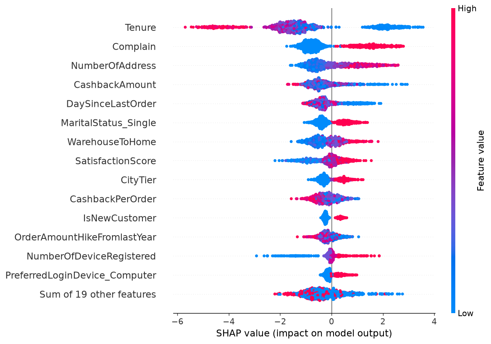

The beeswarm plot puts importance (the vertical order) and direction (the horizontal position and colour) together for every customer:

- Tenure has the widest spread of all, from about −6 to +3.5.
- Complain splits customers into two clean groups.
- NumberOfDeviceRegistered has a long blue tail on the left, which means customers with only a few devices are clearly less likely to churn.
- Our engineered `IsNewCustomer` feature adds a small but clear positive effect on top of Tenure.

## 8. Dependence plots (top 4 features)

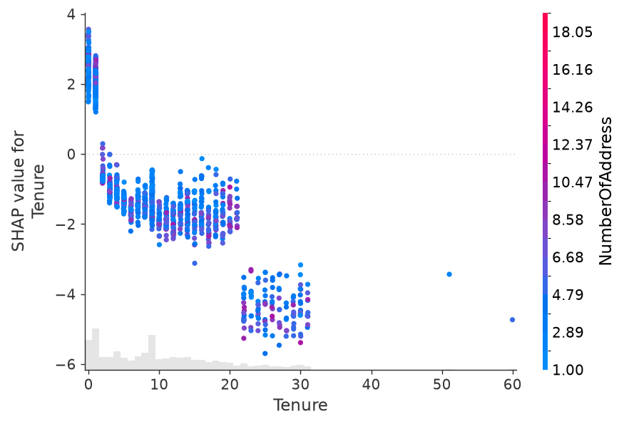

**Tenure.** The effect looks like a staircase. Customers with 0 or 1 month of tenure get +1.2 to +3.6. From about two months the effect drops below zero (−1 to −2), and customers with 22 to 31 months get −3.5 to −5.5. The first month is clearly the critical moment for retention. The colour (NumberOfAddress) doesn't show a strong interaction.

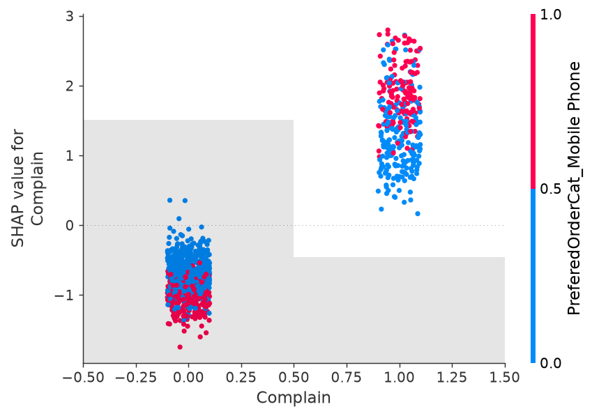

**Complain.** This is a simple jump: about −0.5 to −1.7 without a complaint, and +0.2 to +2.8 with one. Among the customers who complained, those whose favourite category is Mobile Phone (in red) tend to get the highest values. Complaints about phone orders seem to be the most dangerous.

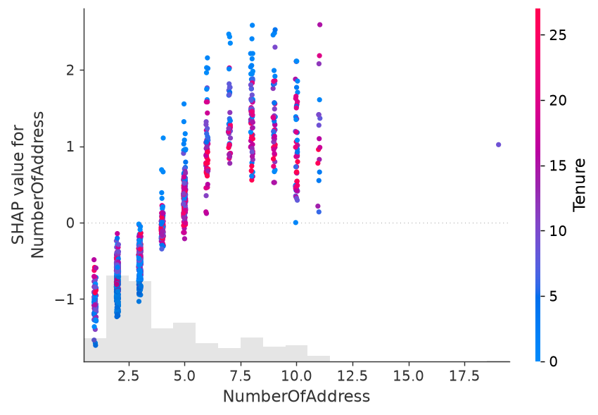

**NumberOfAddress.** One to three addresses lower the risk (−0.2 to −1.6). The effect crosses zero around four or five addresses and reaches +1 to +2.5 for seven to ten. Many delivery addresses could point to a shared or less settled account, which would be worth checking with the business.

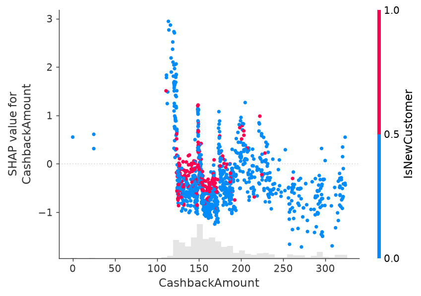

**CashbackAmount.** Customers who received less than about 125 in cashback get strongly positive values (up to +3). Between 125 and 200 the effect is mostly negative, and above 250 it is always negative. The vertical spikes at some amounts come from the trees splitting on the many identical rows in this dataset. Overall, more cashback goes with more loyalty, which makes cashback a natural lever for retention.

## 9. What this means for the business

SHAP turns a churn score into a reason we can act on, customer by customer. The daily batch job could store each customer's churn probability together with their top three SHAP reasons, written in plain language, in the CRM. Marketing and Customer Support then pick the action that fits the reason:

| Main SHAP reason | Suggested action | Team |
|---|---|---|
| `Complain = 1` | A call-back from a senior agent, make sure the ticket is solved, a goodwill gesture | Customer Support |
| Low `Tenure` / `IsNewCustomer` | An onboarding journey: a welcome coupon for the second order, an app tutorial, a check-in after the first month | Marketing (CRM) |
| Low `CashbackAmount` | A targeted cashback offer instead of a generic discount | Marketing |
| Long `WarehouseToHome` | A free or faster delivery offer, and feedback to logistics | Marketing / Operations |
| High `NumberOfAddress` | Check for account sharing or delivery problems | Customer Support |

Looking at the whole customer base, the plots show where the real problems are. Churn is concentrated in the first month and among customers who complained. Onboarding and complaint handling are therefore the two processes worth improving first, and SHAP gives us a way to see whether their weight goes down after the change.

Explanations also build trust. Agents are much more willing to act on a score they understand. They also make it possible to answer a customer or a regulator who asks about an automated decision (GDPR, Article 22).

We should be careful about one thing, though: SHAP explains the model, not the real world. A positive SHAP value for `Complain` means the model relies on complaints to predict churn. It doesn't prove that preventing complaints would stop people from leaving. Some effects, like a recent order or a higher satisfaction score increasing the risk, are probably side effects of how this dataset was built. Correlated features also share the credit between them, such as Tenure and IsNewCustomer, or CashbackAmount and CashbackPerOrder. Any causal claim, and the real effect of each retention action, would have to be tested with A/B tests (a treated group compared with a control group), as we planned in Part 1.
